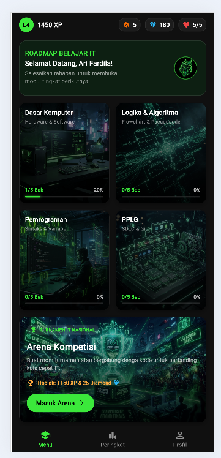
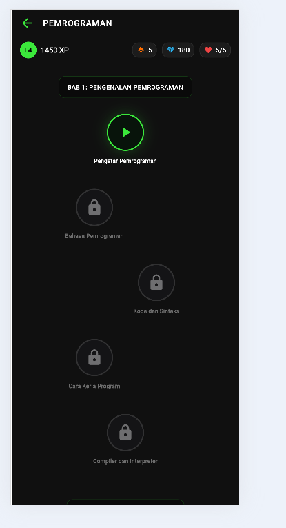
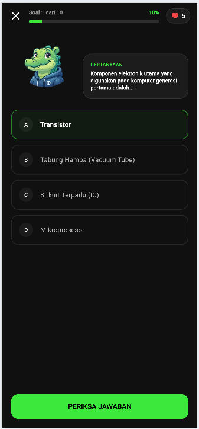
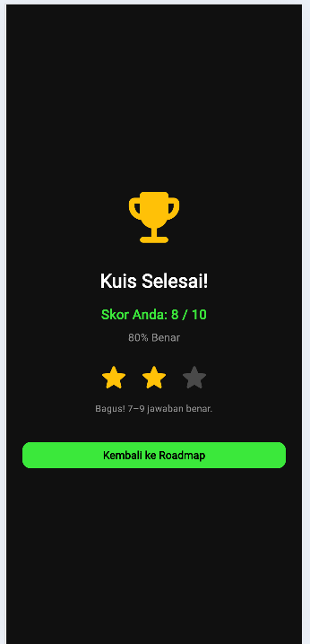
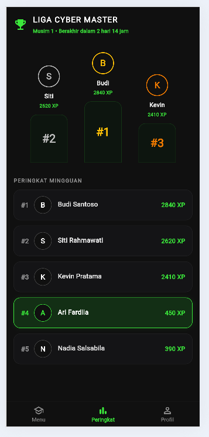
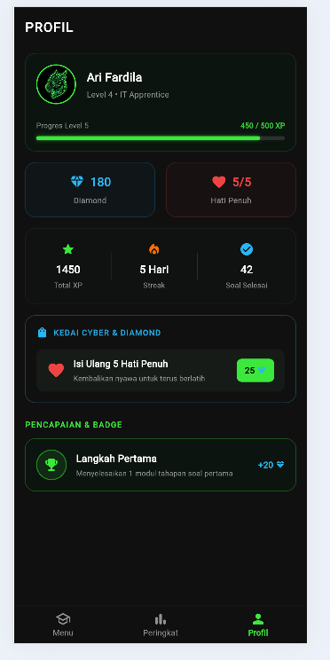

# Grogon

**Grogon** adalah aplikasi mobile platform latihan soal berbasis gamifikasi di bidang Teknologi Informasi. Aplikasi ini dibangun menggunakan **Flutter** dan **Dart**, dengan **Supabase** sebagai backend database serta **Firebase** untuk konfigurasi platform.

Grogon menyajikan soal-soal secara interaktif melalui sistem *learning roadmap* — pengguna menyelesaikan tahapan kuis secara bertahap untuk membuka materi berikutnya. Elemen gamifikasi seperti bintang, XP, hati, diamond, peringkat, dan achievement digunakan untuk meningkatkan motivasi belajar.

Bidang latihan yang tersedia:
- **Dasar Komputer** — Sejarah, komponen, hardware & software, sistem bilangan, dan sistem operasi.
- **Logika & Algoritma** — Flowchart dan pseudocode.
- **Pemrograman** — Sintaks dan variabel.
- **PPLG** — SDLC dan Git.

> Proyek ini dibuat sebagai tugas kuliah **Mobile Programming** Semester 5.

---

## Tangkapan Layar Antarmuka (Screenshot)

### Halaman Utama


### Halaman Roadmap


### Halaman Kuis


### Halaman Hasil Kuis


### Halaman Peringkat


### Halaman Profil


---

## Langkah Menjalankan Proyek

### Persyaratan

- [Flutter SDK](https://docs.flutter.dev/get-started/install) versi 3.47.x atau lebih baru
- Android Studio atau Visual Studio Code dengan ekstensi Flutter & Dart
- Git
- Koneksi internet

### Langkah-langkah

1. **Clone repositori**

   ```bash
   git clone <URL_REPOSITORI>
   cd Grogon
   ```

2. **Instal dependensi**

   ```bash
   flutter pub get
   ```

3. **Jalankan aplikasi**

   Untuk menjalankan di emulator Android atau perangkat fisik:

   ```bash
   flutter run
   ```

   Untuk menjalankan di Chrome (Web):

   ```bash
   flutter run -d chrome
   ```
